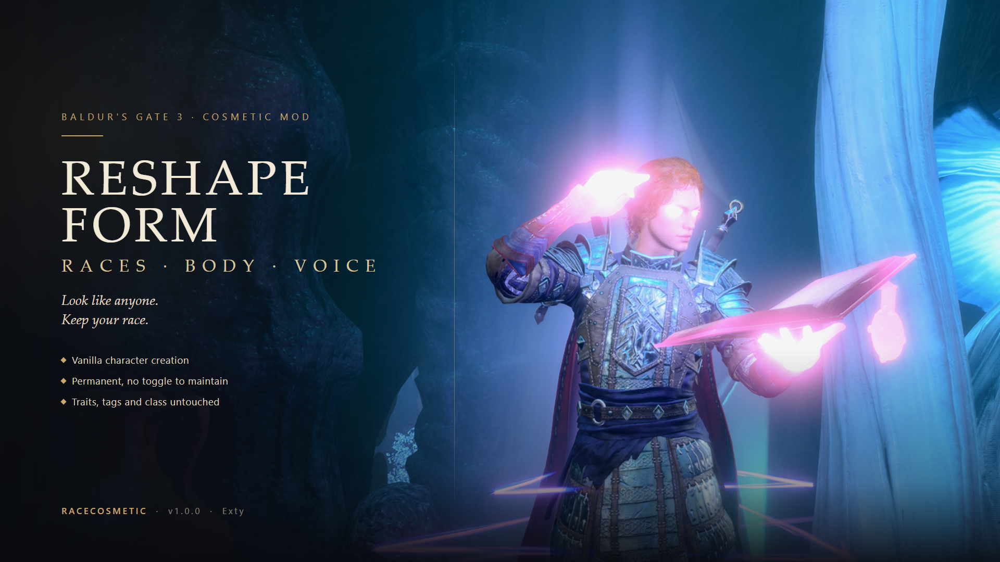

[README.md](https://github.com/user-attachments/files/35224102/README.md)
# RaceCosmetic — Reshape Form

**A Baldur's Gate 3 mod that permanently changes how your character looks, sounds and is built — using the game's own character creation screen — without touching your race mechanics.**



**v1.0.1** · Author: **Exty** · Requires [BG3 Script Extender](https://github.com/Norbyte/bg3se)

📦 **Download:** see [Releases](../../releases) · 🎮 **Also on Nexus Mods:** [link](https://www.nexusmods.com/baldursgate3/mods/899) *(parent mod credit — see [Credits](#credits))*

---

## What it does

Adds a single spell, **Reshape Form**, to your main character's spellbook. Casting it opens the
**vanilla character creation screen**: pick the look of any vanilla race, sculpt the face, hair,
skin, tattoos, horns and tail, and choose a voice.

When you confirm, that look is written onto your character **permanently** — it becomes part of the
character data, so it survives saving, loading, long rests and respecs. There is no transform to keep
active and no toggle to maintain.

**Your race mechanics stay yours:** race name, racial tags, racial traits, class, subclass,
ability scores, background and the Dream Guardian are untouched.

So you can play a duergar for the traits and look like a drow, or mix any other race's appearance
with any other race's mechanics.

---

## Features

| | |
| --- | --- |
| **Vanilla UI** | Uses the game's own character creation screen — no custom interface |
| **Permanent** | Written into character data; survives saves, loads, long rests and respecs |
| **Consistent** | World model, **level up screen** and character sheet all agree |
| **Mechanics preserved** | Race name, tags, traits, class, ability scores, background |
| **Respec safe** | Withers' respec still grants your original race's traits, never the borrowed race's |
| **Voice included** | Body type and voice are part of the swap |
| **Any vanilla race** | Including cross-body-type combinations |
| **Bilingual** | English and Simplified Chinese |
| **Lightweight** | No ImpUI, no MCM, no third-party assets |

---

## Requirements

- **BG3 Script Extender** (Norbyte) — required
- Baldur's Gate 3, patch 8 tested
- **PC only** — Script Extender does not exist on console
- Single player, main character only

---

## Installation

1. Install [BG3 Script Extender](https://github.com/Norbyte/bg3se).
2. Copy `RaceCosmetic.pak` into `%LOCALAPPDATA%\Larian Studios\Baldur's Gate 3\Mods\`.
3. Enable **RaceCosmetic** in BG3 Mod Manager and move it to the **bottom** of the load order.
4. Load your save, open the spellbook (`K`), find **Reshape Form**.

### Usage

1. Make sure the party has a **free slot** (max 4) — the mod briefly adds a temporary character.
2. Cast **Reshape Form** outside combat.
3. Create the look you want and confirm.
4. Wait 2–3 seconds; the temporary character is removed and control returns to you.

To change your look again later, simply cast the spell again.

---

## How it works

The interesting part is not the shapeshift — it is that **the game draws a character from several
independent layers**, and preview screens (level up, character sheet) rebuild the model from those
layers instead of reusing the live one:

| Layer | Component / field | Written? | Why |
| --- | --- | --- | --- |
| Appearance parts | `CharacterCreationAppearance` | ✅ | head, hair, tattoos, makeup |
| Body | `BodyType` | ✅ | body type / gender |
| Visual template | `GameObjectVisual` | ✅ | which model/skeleton previews build |
| Applied look cache | `AppearanceOverride` | ✅ | stops previews rendering a stale look |
| Armour variant | `EquipmentRace`, `CharacterVisualResourceID`, `VisualTemplate` (on `ServerCharacter.Template`) | ✅ | otherwise armour keeps the old body's fit |
| Skeleton / race | `Race` component | ❌ | not needed once the template is written |
| Creation race | `CharacterCreationStats.Race/SubRace` | ❌ | **this is what respec reads** — writing it made respecs grant the borrowed race's traits |
| Identity | template `Race` / `Id`, class, feats, attributes | ❌ | that is what keeps name, tags and traits yours |

Writing only *some* layers produces the classic "new head on an old body" mess, so the mod writes
them together and **aborts the whole write** if `AppearanceOverride` cannot be created — a
half-applied write is worse than none.

Tags that the shapeshift rule strips are restored right after the swap.

`src/…/RaceData.lua` holds a race-parent table generated from the game's own `Races.lsx`; it is used
to repair characters that were converted by pre-1.0.1 builds. Regenerate it with
`tools/gen-race-data.py`.

---

## Known limitations

- **Free party slot required.** The mod briefly adds a temporary character (max party 4). If the
  party is full the reshape is cancelled and the log says so.
- **Portraits do not refresh automatically.** Use the magic mirror or reload the save.
- **The game logs a "dream visitor died" combat log line** while the temporary character is cleaned
  up. Engine-side, cannot be suppressed (Appearance Edit Enhanced shows the same). Harmless.
- **No revert spell by design.** The change is permanent — reshape again to pick a new look.
- **Do not use it together with Appearance Edit Enhanced's mirror entry.** Both open character
  creation; pick one.

---

## Save game compatibility

Builds before 1.0.1 wrote the picked race into the character's creation data, which made Withers'
respec hand out the borrowed race's traits (while the name and tags stayed original). That is fixed
by not writing those fields at all.

Characters converted with an older build are repaired automatically when the save is loaded: the
creation data is put back in sync with the real race, and the **next** respec grants the correct
traits again (already-granted traits are not revoked retroactively).

---

## Building from source

Requires [LSLib](https://github.com/Norbyte/lslib) (`Divine.exe`).

```powershell
# default: looks for ..\modtools\Packed\Tools\Divine.exe next to this folder
powershell -NoProfile -ExecutionPolicy Bypass -File .\build.ps1

# or point at Divine explicitly
powershell -NoProfile -ExecutionPolicy Bypass -File .\build.ps1 -Divine "C:\path\to\Divine.exe"
```

`install.ps1` copies the built package into the game's `Mods` folder and registers it in
`modsettings.lsx` (it refuses to run while the game is open, and backs up `modsettings.lsx` first).

---

## Credits

The approach is inspired by **[Appearance Edit Enhanced](https://www.nexusmods.com/baldursgate3/mods/899)**
by **Eralyne** — specifically how the game caches the applied look in `AppearanceOverride`, and how
template fields such as `EquipmentRace` select armour variants.

This is an **independent implementation**: the code was written with AI coding assistance, guided and
tested in game by the author. No Lua code, data tables or art assets from AAE are reused, and the
package contains no third-party assets. Eralyne has been contacted on Nexus to credit the original work.

---

## License

MIT — see [LICENSE](LICENSE). Redistribution of the built package is fine as long as Larian's mod
policy is respected (no paywalls).
